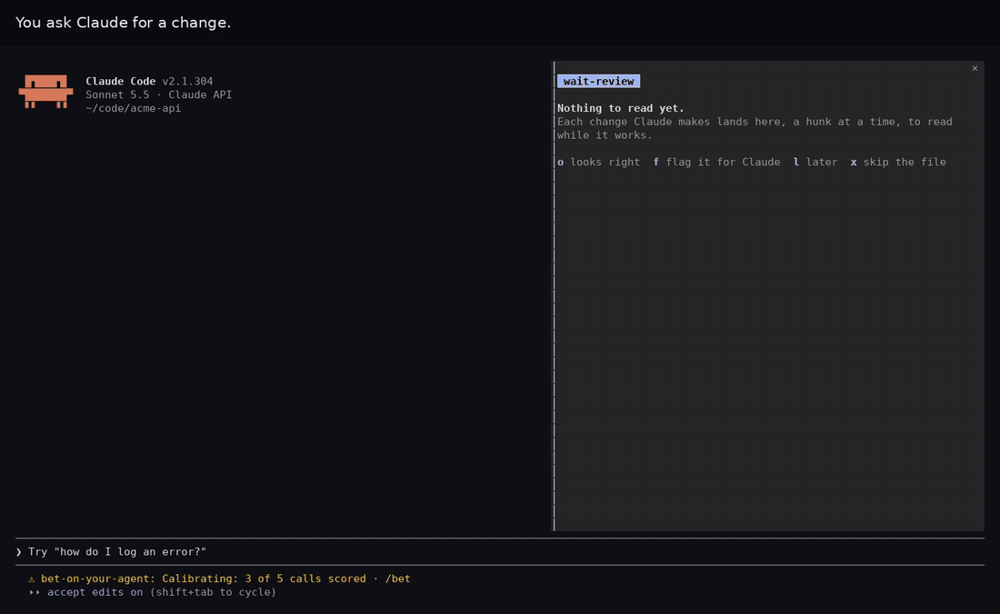

<p align="center">
  
</p>

<h1 align="center">Waitroom</h1>

<p align="center">Seven small Claude Code plugins for the time your agent is thinking.</p>

<p align="center">
  <a href="LICENSE"></a>
  &nbsp;
  <a href="https://github.com/coindef/waitroom/stargazers"></a>
  &nbsp;
  
</p>

## Install

```sh
claude plugin marketplace add coindef/waitroom && claude plugin install waitroom@waitroom
```

That installs wait-review, bet-on-your-agent, wait-ship, and wait-breathe. Add the other three one at a time:

```sh
claude plugin install wait-changed@waitroom
claude plugin install wait-ping@waitroom
claude plugin install wait-scope@waitroom
```

Restart Claude Code afterwards. Single-plugin installs, updating, and the old name: [docs/install.md](docs/install.md).

## Plugins

- 🔍 **[wait-review](./wait-review)** — Review the diff Claude already wrote, a hunk at a time, and send what you flag back with your next message. A pane. On.
- 🎯 **[bet-on-your-agent](./bet-on-your-agent)** — Call how the turn will go and get scored afterwards on your calibration. The row. On.
- 🚢 **[wait-ship](./wait-ship)** — Drafts the commit message, PR description, and changelog entry for you to review. The row. On.
- 🌬️ **[wait-breathe](./wait-breathe)** — One quiet line during a long turn: a posture check, an eye break, a breath, a stretch. The row. Off until /breathe.
- 📋 **[wait-changed](./wait-changed)** — Lists the files a turn changed, once it has ended. The row. On.
- 🔔 **[wait-ping](./wait-ping)** — A local notification when a long turn ends or a permission confirm is waiting. The OS. On.
- 🎯 **[wait-scope](./wait-scope)** — Flags files a turn edited outside the scope you set, and never blocks them. The row. On.

How they share the screen: [docs/design.md](docs/design.md).

## Demo

<p align="center">
  
</p>

<p align="center"><em>A real session, sped up only while Claude works. <a href="docs/demo.mp4">Full-length video</a>.</em></p>

---

Requires Claude Code 2.1.291+ and, for wait-review and wait-ship, a git repository ([details](docs/install.md#requirements)).
[Troubleshooting](docs/troubleshooting.md) · [Contributing](CONTRIBUTING.md) · [Changelog](CHANGELOG.md) · MIT, see [LICENSE](LICENSE).
