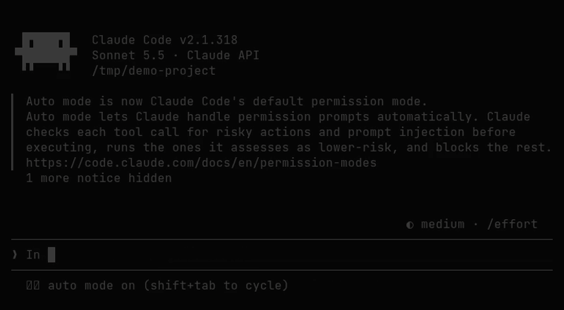

<p align="center"></p>

<h2 align="center">Claude is thinking. Call the turn.</h2>

<p align="center"></p>

<p align="center">While Claude works, you call how the turn will go. Waitroom keeps score.</p>

<p align="center"><sub>Called it? Star it. Missed it? Star it anyway. We won't tell Claude.</sub></p>

## Install

```sh
claude plugin marketplace add coindef/waitroom
claude plugin install bet-on-your-agent@waitroom
```

Restart Claude Code. On your next turn, the bet row above the prompt asks for your first call. You need Claude Code 2.1.291 or later. If `claude --version` shows an older one, run `claude update`.

<details>
<summary>Install wait-ship, wait-breathe, wait-notify, and the optional rooms</summary>

```sh
claude plugin install wait-ship@waitroom
claude plugin install wait-breathe@waitroom
claude plugin install wait-notify@waitroom
```

wait-ship needs a git repository. wait-breathe stays off until you run `/breathe`. wait-notify is macOS only: after install and a restart, it notifies when Claude is blocked on you and you're away from the terminal, and stays silent while you're active there.

Optional rooms:

```sh
claude plugin install wait-secret@waitroom
claude plugin install wait-scope@waitroom
claude plugin install wait-ping@waitroom
claude plugin install wait-anchor@waitroom
claude plugin install wait-cards@waitroom
```

wait-ping is the legacy notifier. It sends a desktop notification when a long turn ends or a permission prompt is waiting. wait-anchor keeps a note you set, the goal and what to check when you come back, and stays quiet until you set one. wait-cards shows one flashcard from a deck you write in `~/.waitroom/cards.md`, and stays quiet until that file has cards.

Restart Claude Code once you're done. If `waitroom@waitroom` fails to load with `Dependency "wait-review@waitroom" is not installed` after a marketplace update, see the migration note in [docs/install.md](docs/install.md#if-waitroom-fails-after-a-marketplace-update).

To update, or to install the three core rooms in one command, see [docs/install.md](docs/install.md).

</details>

## Who this is for

You run long Claude Code turns. You alt-tab. Now you call the turn instead.

- You think you know which tasks Claude will land first try. bet-on-your-agent checks your calls against what happened. After five scored calls, `/bet` tells you something like "You run 12 points overconfident."
- You like a scoreboard, even one only you can see. Your last 20 scored calls set your rank, from Coin-Flipper up to Oracle.
- You keep your tools local. Waitroom needs no account and makes no network calls. Your record stays on your machine.

## Quick start

1. [Install](#install) bet-on-your-agent and restart Claude Code.
2. Give Claude a real task. While it works, the bet row asks if the turn will land first try. Type 1 to 5 to say how sure you are, where 4 means 90%. Then call how many files it will touch.
3. When the turn ends, the row asks "Did it land?" Type 1 for Landed or 2 for Needed fixing. Run `/bet` to see your record and your rank.

## Rooms

### Core

| &nbsp;&nbsp;&nbsp;&nbsp;&nbsp;&nbsp;&nbsp;&nbsp;&nbsp;&nbsp;&nbsp;&nbsp;Room&nbsp;&nbsp;&nbsp;&nbsp;&nbsp;&nbsp;&nbsp;&nbsp;&nbsp;&nbsp;&nbsp;&nbsp; | What it does |
|---|---|
| <br>[bet-on-your-agent](./bet-on-your-agent) | **Call the turn. Get scored.**<br>Call how the turn will go, then see how well your calls match what happened. The status row, on by default. |
| <br>[wait-breathe](./wait-breathe) | **Your lungs need a turn too.**<br>Shows one quiet line during a long turn, such as an eye break or a stretch. The status row, off until you run /breathe. |
| <br>[wait-ship](./wait-ship) | **Commit msg? Already cooked.**<br>Drafts the commit message, PR description, and changelog entry for you to review. The status row, on by default. |
| <br>[wait-notify](./wait-notify) | **Go outside. We'll yell.**<br>macOS notification when Claude needs you and you're away. Silent while you're at the terminal. One reminder after 3 minutes. |

### Optional

| &nbsp;&nbsp;&nbsp;&nbsp;&nbsp;&nbsp;&nbsp;&nbsp;&nbsp;&nbsp;&nbsp;&nbsp;Room&nbsp;&nbsp;&nbsp;&nbsp;&nbsp;&nbsp;&nbsp;&nbsp;&nbsp;&nbsp;&nbsp;&nbsp; | What it does |
|---|---|
| <br>[wait-secret](./wait-secret) | Flags lines a turn wrote that look like a key or a token. Local only, and it only warns. The status row, after the turn ends. |
| <br>[wait-scope](./wait-scope) | Flags files a turn edited outside the scope you set, and never blocks them. The status row, on by default. |
| <br>[wait-anchor](./wait-anchor) | **Leave a note for future you.**<br>You set the goal and what to check when you come back. The status line, only while a note is set. |
| <br>[wait-cards](./wait-cards) | **Learn something while it cooks.**<br>A question from your own deck while Claude works, the answer when the turn ends. Mark it with `/card got` or `/card miss`. The status line, only while you have cards. |

How the rooms share the screen is in [docs/design.md](docs/design.md).

---

[Troubleshooting](docs/troubleshooting.md) · [Contributing](CONTRIBUTING.md) · [Changelog](CHANGELOG.md) · MIT, see [LICENSE](LICENSE).
