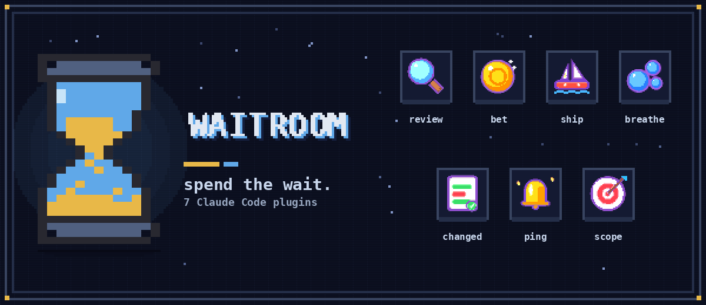
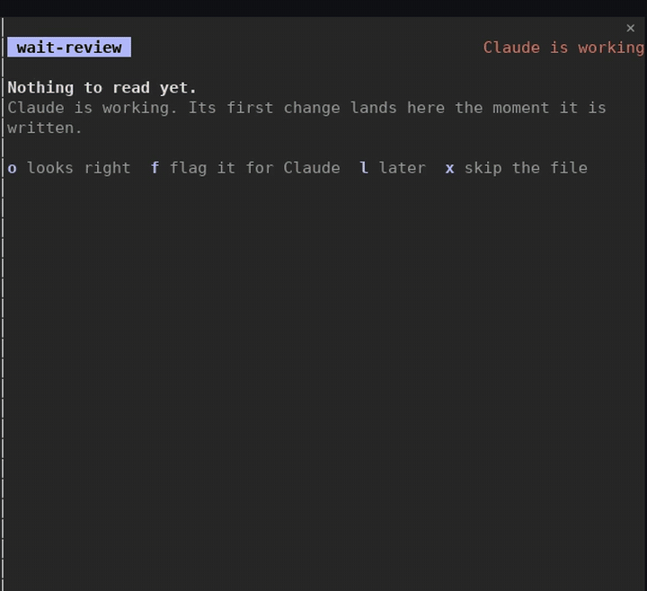
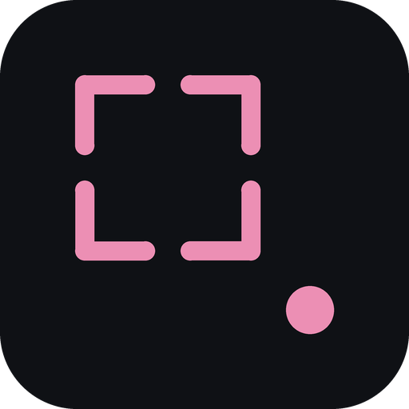
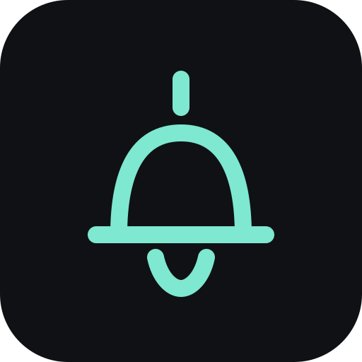

<p align="center">
  
</p>

<h1 align="center">Waitroom</h1>

<p align="center">Claude is thinking. Here's something to do while you wait.</p>

<p align="center">
  
</p>

<p align="center">If it saved you a boring minute, a star helps.</p>

```sh
claude plugin marketplace add coindef/waitroom
claude plugin install bet-on-your-agent@waitroom
claude plugin install wait-breathe@waitroom
claude plugin install wait-ship@waitroom
```

## Rooms

### Core

| | Room | What it does |
|---|---|---|
|  | [wait-breathe](./wait-breathe) | Shows one quiet line during a long turn, such as an eye break or a stretch. The status row, off until you run /breathe. |
|  | [bet-on-your-agent](./bet-on-your-agent) | Call how the turn will go, then see how well your calls match what happened. The status row, on by default. |
| | wait-notify | Coming soon. A macOS notification when Claude needs input, and one reminder after 3 idle minutes. |

### Also

| | Room | What it does |
|---|---|---|
|  | [wait-ship](./wait-ship) | Drafts the commit message, PR description, and changelog entry for you to review. The status row, on by default. |

### Optional

| | Room | What it does |
|---|---|---|
|  | [wait-secret](./wait-secret) | Flags lines a turn wrote that look like a key or a token. Local only, and it only warns. The status row, after the turn ends. |
|  | [wait-scope](./wait-scope) | Flags files a turn edited outside the scope you set, and never blocks them. The status row, on by default. |
|  | [wait-ping](./wait-ping) | wait-ping: basic ping when Claude needs input. Will be replaced by wait-notify. |

How the rooms share the screen is in [docs/design.md](docs/design.md).

## Install

The command above installs bet-on-your-agent, wait-breathe, and wait-ship. Optional rooms install on their own:

```sh
claude plugin install wait-secret@waitroom
claude plugin install wait-scope@waitroom
claude plugin install wait-ping@waitroom
```

Restart Claude Code afterwards. Requires Claude Code 2.1.291 or later, and a git repository for wait-ship. Single-plugin installs and updates are in [docs/install.md](docs/install.md).

---

[Troubleshooting](docs/troubleshooting.md) · [Contributing](CONTRIBUTING.md) · [Changelog](CHANGELOG.md) · MIT, see [LICENSE](LICENSE).
