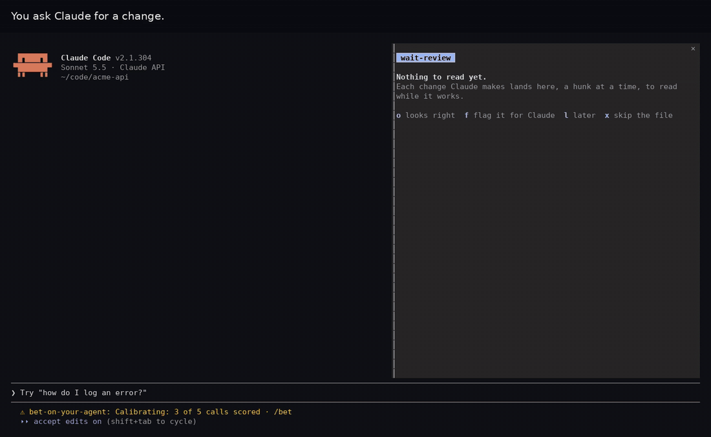
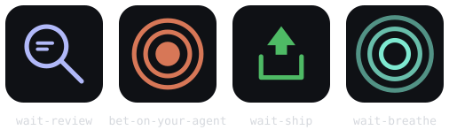
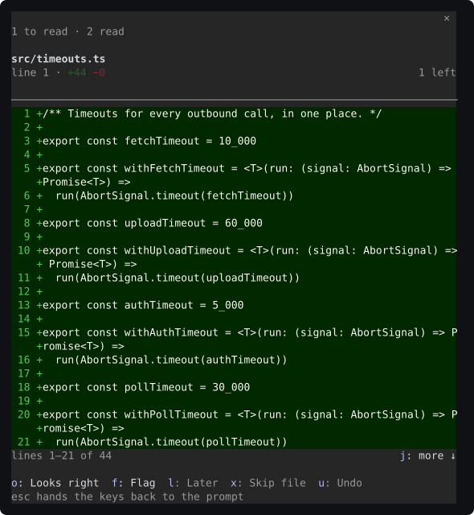

# waitroom

Four Claude Code plugins for the dead time while a coding agent works. The
wait is the one moment you are already holding the problem in your head and
have nothing to do with it; these spend it on the diff the agent just wrote,
on how well you called the turn, on the commit message and PR description
that will ship it, and — quietly, off by default — on a long turn's toll on
you.



*A real session, not a mockup — Claude Code 2.1.304 with both plugins, sped up
only while Claude works; this is a 15-second cut of it. Bet on the turn while
it runs, read the diff as it lands, flag a hunk with a reason, and "Fix what I
flagged" is all the next message needs. [Full-length video](docs/demo.mp4).*



One family, four rooms: a magnifying glass for the diff, a target for your
calibration, an outbox for what ships, and a breathing ring for you.

## Install

Two steps. Start with the two that make the core loop — read the diff as it
lands, call how the turn will go — and add the other two once those feel at
home.

### Step 1: wait-review and bet-on-your-agent

One paste, in a terminal:

```sh
claude plugin marketplace add coindef/waitroom
claude plugin install wait-review@waitroom
claude plugin install bet-on-your-agent@waitroom
```

Then start Claude Code (restart it, if it was already running). Both run on
their defaults — no key, no service, nothing written to your repository. The
installer's `userConfig options not yet set` lines are fine: every option has
a working default ([more](#what-the-installer-says-on-the-way-in)).

Already at the Claude Code prompt? Send the same three as slash commands
instead, each as its own message — `/plugin marketplace add coindef/waitroom`,
then `/plugin install wait-review@waitroom`, then `/plugin install
bet-on-your-agent@waitroom` — and save each install screen as it is. That
answers `Installed and configured wait-review. Plugin is now active.`, active
in that session straight away.

### Step 2, when you want them: wait-ship and wait-breathe

```sh
claude plugin install wait-ship@waitroom
claude plugin install wait-breathe@waitroom
```

(Or `/plugin install wait-ship@waitroom` and `/plugin install
wait-breathe@waitroom` at the prompt.) wait-ship drafts the commit message, PR
description and changelog entry once a turn has changed files. **wait-breathe
starts off**: installed, it stays silent until you send `/breathe`, which turns
it on — and off again, the next time you send it.

Every line in both steps is safe to run again: adding a marketplace that is
already there, or installing a plugin that already is, changes nothing. With
all four in, `/plugin` reads `4 mods active · wait-review, bet-on-your-agent,
wait-ship, wait-breathe`.

It needs **Claude Code 2.1.291 or later** — `claude --version` says which you
have, `claude update` moves you on. An older build installs it without
complaint and then shows it as `failed to load`; see
[If a plugin shows an error](#if-a-plugin-shows-an-error).

The first line adds the marketplace from its repository path,
`coindef/waitroom`. From then on it goes by its name, **`waitroom`** — the part
after the `@`.

You may also see the one-line form, `/plugin install wait-review --marketplace
coindef/waitroom`. It works once. Sent again, it answers `Plugin "wait-review"
not found in any marketplace`, because by then `--marketplace` wants the name
`waitroom`, not the repository path. The lines above have no such trap.

### Updating

Run these at the prompt, then **restart Claude Code** — an update is written to
disk straight away but only loaded by the next session:

```
/plugin marketplace update waitroom
/plugin update wait-review@waitroom
/plugin update bet-on-your-agent@waitroom
/plugin update wait-ship@waitroom
/plugin update wait-breathe@waitroom
```

Each reports `updated from` the old version `to` the new one, or `already at
the latest version` for a mod that has not changed. What changed, and in which
mod, is in [CHANGELOG.md](./CHANGELOG.md); if one it lists as changed still
says it is at the latest version, the marketplace was not refreshed yet, so run
the first line again.

### Coming from the old name

The repository was called `Plugin`, and the marketplace `wait-mods` (in the
very first release, `wait-review`). If you installed under one of those, the
stale marketplace is still registered and has to go before the new one can take
its place. `/plugin marketplace list` shows which you have. Removing a
marketplace uninstalls the plugins that came from it, so remove the old one,
then install again:

```
/plugin marketplace remove wait-mods
/plugin marketplace add coindef/waitroom
/plugin install wait-review@waitroom
/plugin install bet-on-your-agent@waitroom
```

(From the first release, the first line is `/plugin marketplace remove
wait-review` instead.) Leave the old one in place and one of the two copies
reports `holds the same plugin name and comes first` — see
[If a plugin shows an error](#if-a-plugin-shows-an-error).

bet-on-your-agent's record does not come with it: each install keeps its own,
so your calibration starts fresh under the new name.

## Requirements

- **Claude Code 2.1.291 or later, run interactively** — the current stable
  release, 2.1.304, is fine. Checked live on 2.1.291, 2.1.292, 2.1.300,
  2.1.302 and 2.1.304. Older builds do not run them, and `claude update` is the fix:
  - before 2.1.242, the plugins show `failed to load` (below);
  - 2.1.242 to 2.1.280 install them but reject their hooks module, which uses
    state helpers those builds predate (`claude plugin validate` says so on
    2.1.242, 2.1.260 and 2.1.280);
  - 2.1.281 to 2.1.290 accept the module but were not run live.
- **A git repository** for wait-review and wait-ship. Both read the diff, so
  outside one they have nothing to show. bet-on-your-agent and wait-breathe
  work anywhere.
- Plugins that hook Claude Code's own events are **early access**. See
  [If a plugin shows an error](#if-a-plugin-shows-an-error).

## The first minute

**wait-review** needs no setup. Ask Claude for a change; when the turn ends, the
pane starts offering the diff a hunk at a time — here paging through a hunk
longer than the pane, with one already flagged:



**Give the pane the keys first: `/wait-review` or `ctrl+x tab`** (or click
it). Its letters only work while it holds the keyboard — press `o` without that
and you type an `o` into your prompt. The pane reminds you at the bottom, and
`esc` hands the keys back when you are done. `/wait-review` always works;
`ctrl+x tab` gives the keys to the row above the prompt instead while that row
has buttons up, as it does when bet-on-your-agent asks "Did it land?".

| Key | Does |
|---|---|
| `o` | Looks right — next hunk |
| `f` | Flag it; it goes to Claude with your next message |
| `n` | After `f`: say why, in a line |
| `l` | Later — comes back once the rest are read |
| `x` | Skip the rest of this file |
| `u` | Undo the last call |
| `j` / `k` | Read on / back through a hunk longer than the pane |

A new file is a single hunk as long as the file, so `j` matters more than it
looks: the pane shows `lines 1–30 of 200` and pages through the rest.

Running `/wait-review` opens the pane already holding the keyboard, so the
letters answer at once. The pane that opens by itself at the start of a session
deliberately does not take the keys: it would eat the first keystrokes of a
prompt you have not sent yet.

If the pane never appears, your terminal is under 144 columns — a pane nobody
asked for needs that much room. Run `/wait-review` and it opens at any width.
The status line tells you so:

```
wait-review: 3 to read · open with /wait-review
```

**On Claude Code 2.1.304 or later**, Claude Code has a diff panel of its own,
and it opens beside the transcript the first time Claude edits — in front of
wait-review's pane. Send `/diff` once to hide it. Claude Code remembers that,
so the side is wait-review's from then on, in later sessions too; `/diff` again
brings the built-in panel back whenever you want it. If you run `/wait-review`
and see nothing, its reply says when this is why.

**bet-on-your-agent** scores your calibration, not a wager — it keeps no
currency and no winnings, just whether you called it — by putting a question
above the prompt while a turn runs:

```
 bet  Will "add the retry logic to the client" land first try?
1: 50%  2: 65%  3: 80%  4: 90%  5: 95%  0: Skip
```

Type a bare digit into the empty composer and it answers — no pane, no focus,
no click. `/bet` shows what it has learned about you. For your first week that
and the file count are all it asks; the extras — a bonus question, a daily
challenge, a badge wall — wait in `/bet-recap` until then.

**wait-ship** needs no setup either. When a turn ends having changed anything,
the same row offers the kit it drafted — a commit message, a PR description,
and, where `CHANGELOG.md` exists, a changelog entry:

```
 ship  Drafts ready: feat(wait-ship): add hooks/ship.ts +2 more · commit 412B · PR 1.1KB · changelog 180B
a: Accept all  m: More  s: Skip
Drafts — read them before using them.
```

Its keys are letters, so give the row the keys first — `ctrl+x tab`, or a
click — then `a` takes every draft and `s` skips. `m` puts each draft on a key
of its own (`c` commit message, `p` PR body, `l` changelog, `e` drafts for
editing). A letter typed into the composer stays in the composer; only
bet-on-your-agent's digits answer from there. Accepted drafts land under
`.waitroom/ship`, a folder that ignores itself in git, with the exact command
to run printed in the transcript — nothing here ever runs on your behalf.
**A turn that changed nothing gets no row**, even with earlier changes still
uncommitted.

**wait-breathe** is the one mod that starts off — send `/breathe` to turn it
on (see [Install](#install) above). Once it is on, a single turn running past
`longTurnSeconds` (90s by default) gets one quiet line, never more than one
every ten minutes:

```
 breathe  4-4-4 breathing: in for 4, hold for 4, out for 4 b: Took it
```

No health claim, no "you should" — just the action, rotating so it is never
the same one twice running. `/breathe` turns it on, and off again; the same
switch is *Enable the breathing nudges* under `/plugin` → wait-breathe.

## What they are

| Mod | What it does |
| --- | --- |
| [**wait-review**](./wait-review) | Offers the diff the agent already wrote, one hunk at a time, and sends what you flag — with your reason — back with your next message. |
| [**bet-on-your-agent**](./bet-on-your-agent) | Forecast how the turn will go from the row above the prompt, then see a Brier score and a calibration table that shows exactly where your confidence runs hot or cold. |
| [**wait-ship**](./wait-ship) | Drafts the commit message, PR description and changelog entry for the turn's changes, so you can review the words the way wait-review lets you review the code. |
| [**wait-breathe**](./wait-breathe) | A quiet reminder to take care of yourself during a long turn — a posture check, an eye break, a breath, a stretch — off by default until you turn it on. |

## The idea behind all four

The cost of waiting on a coding agent is not boredom, it is context collapse. A
90-second wait filled with something entertaining costs minutes of refocus on
the way back, and any game with a win condition quietly teaches you to want the
agent to be slow. You also cannot win on entertainment: the person already has a
phone.

So none of these compete with a phone. Each spends the wait on something that
is only available *during* the wait, needs no context switch to start, and can
be abandoned mid-thought:

- **wait-review** spends it on the diff, because the agent now writes code
  faster than anyone reads it and a session otherwise ends with a large diff
  nobody reviewed.
- **bet-on-your-agent** spends it on a forecast, because knowing how far to
  trust the agent is the skill that matters most and is currently learned by
  vibes.
- **wait-ship** spends it on the words around the diff, because a commit
  message and a PR description are worth getting right too, and writing them
  well after the fact competes with whatever comes next instead of riding the
  one moment the change is already fresh in mind.
- **wait-breathe**, alone of the four, spends it on you rather than the work —
  the same wait that is free for the others to fill is the only unscheduled
  moment in a long session. It is off by default because not everyone wants a
  plugin making that particular claim on their attention.

They compose rather than compete for room: **wait-review** takes the pane,
and the other three share the row just above the prompt, one at a time — a
breathe nudge first, then a ship offer, then the bet's question — so two sets
of buttons never stack on it; the one behind waits its turn. While a turn runs,
the bet's forecast gives way only to a breathe nudge, since the window to call
the turn closes when it lands. bet-on-your-agent asks what you expect from what
Claude is writing, wait-ship hands you the words for what it just wrote, and
wait-breathe — once you turn it on — asks something of you instead of Claude.

## If a plugin shows an error

**`failed to load`, or `✗ 1 error` on its row in `/plugin`, most likely means
Claude Code is too old.** The error itself reads like this:

```
Hook load failed: [ { "expected": "record", "code": "invalid_type",
  "path": [ "hooks" ], "message": "Invalid input: expected record, received undefined" } ]
```

Builds before 2.1.242 cannot read the hooks module these plugins are built on,
so every plugin built that way fails to load the same way — including ones from
other marketplaces. Run `claude update`, restart, and they load. (Reproduced on
2.1.200 and 2.1.241; 2.1.242 is the first build that reads it.)

Otherwise, check whether they are running at all. Open `/plugin`: when all
four are loaded, the line under the tabs reads

```
4 mods active · wait-review, bet-on-your-agent, wait-ship, wait-breathe
```

If one is missing from it, the **Errors** tab in the same menu names the reason
— so does `claude --debug`, on a line starting `hooks module wait-review@waitroom
not loaded:`. What it can say:

| It says | What it means | What to do |
| --- | --- | --- |
| `Its hooks module does not load. "wait-review@…" holds the same plugin name and comes first` | Two copies are installed — almost always one from the old `wait-mods` marketplace beside the new one | `/plugin marketplace remove wait-mods` removes the old copy with its marketplace. See [Coming from the old name](#coming-from-the-old-name) |
| `hooks modules are turned off for installed plugins in this process: …` | The early-access switch, below | Depends on the rest of the line |
| `only managed plugins and built-in plugins run (allowManagedHooksOnly / disableAllHooks)` | Your organization's managed settings allow only its own plugins' hooks | Ask whoever manages Claude Code for you |
| `… load no hooks module in this mode (--bare)` | Claude Code was started with `--bare` | Start it without `--bare` |

No error anywhere, and no `mods active` line at all, means `disableAllHooks` is
on in your settings. It turns off every hook, these included.

The same "holds the same plugin name" error appears if you run
`claude --plugin-dir ./wait-review` while the installed copy is enabled. Disable
the installed one while you work on a clone.

### The early-access switch

Plugins that hook the engine's own events are **early access**, gated by a
rollout switch. The end of the line says which state it is in:

- **`this wake's flag fetch has not answered the rollout switch`** is the
  harmless case. The process started before the answer arrived, and the mods
  load at the next turn start once it does — the debug log then shows `…
  loaded (worker, environment 4, tier user)`. A short `claude -p` run can end
  in that gap; an interactive session never does.
- **`the rollout switch was saved off by an earlier session and is not refreshed
  yet`** is a stale answer. Start `claude` once with network access and it
  refreshes.
- **`the rollout switch served off`** means the switch is off for this build or
  account. Nothing in these mods can turn it on, and they load by themselves
  once it reads on.

Either way the switch is not about these mods in particular: it holds back
every installed plugin that carries a hooks module, whoever made it.

## What the installer says on the way in

**"4 userConfig options not yet set"** is informational: every option has a
working default and the plugin runs on them — the debug log puts it as `every
option is its default`. Configure them to change something, not to get started.

## Developing

Each mod is a self-contained plugin folder. From the repository root:

```
claude plugin validate ./wait-review
claude plugin test     ./wait-review          # 84 tests

claude plugin validate ./bet-on-your-agent
claude plugin test     ./bet-on-your-agent    # 129 tests

claude plugin validate ./wait-ship
claude plugin test     ./wait-ship            # 70 tests

claude plugin validate ./wait-breathe
claude plugin test     ./wait-breathe         # 27 tests
```

Neither of those runs a real type checker, so also run `tsc` from each mod's
folder once it has loaded at least once (that's what writes
`.claude-plugin/types/`, which the mod's `tsconfig.json` points at):

```
npx -y -p typescript@5.7 tsc -p .
```

(`typescript@latest` currently ships a rewritten `tsc` whose CLI rejects
`-p` outright — pin a 5.x release rather than chasing that down again.) A
clean run prints nothing. This caught a real bug once already (two call
sites where a status literal silently widened to `string` inside a `.map`,
erasing the protection `HunkStatus` was there to give) that 84 passing tests
and a clean `validate` both missed — run it after any change to any mod's
`hooks/`, not just when something looks wrong.

Run a working copy without installing it, or install from this clone so edits
reload in place:

```
claude --plugin-dir ./wait-review
# or
claude plugin marketplace add .     # then /plugin install <mod>@waitroom
```

Each mod keeps the logic that needs no engine in one plain module
(`hooks/diff.ts`, `hooks/bet.ts`, `hooks/ship.ts`, `hooks/breathe.ts`) so it
can be tested directly, with the hooks module beside it and a
`types/index.d.ts` state contract that `claude plugin validate` holds it to.
Each mod's own `tests/flow.test.*` or `tests/band.test.tsx` drives the real
loop through the engine, git and all.

`.claude-plugin/types/` inside a mod is written by the engine on each load and
is not checked in.

### userConfig conventions

Two option names recur across mods; a new one should follow the same meaning
rather than pick a fresh one:

- **`autoOpen`** governs whether a mod's *pane* opens by itself at session
  start — not whether the mod itself runs. Its default follows whether the
  pane is that mod's main surface or a secondary record: `true` for
  wait-review, whose pane is where it does its work; `false` for
  bet-on-your-agent, whose main surface is the row above the prompt, so the
  pane is only worth the screen space once you ask for it with `/bet`.
- **`enabled`** is a master switch, present only on mods with a core behavior
  worth turning off entirely — wait-ship and wait-breathe. wait-review and
  bet-on-your-agent have no `enabled` key at all, because neither has a mode
  where it does nothing; they are always on. Where `enabled` exists, default
  it to whatever keeps the mod's main claim on the user modest: `true` for
  wait-ship (drafting costs nothing until you act on a draft), `false` for
  wait-breathe (its claim is on your attention, not your screen).

### OpenCode prototypes

[`wait-review-opencode`](./wait-review-opencode) and
[`bet-on-your-agent-opencode`](./bet-on-your-agent-opencode) are unpublished
prototypes of the same two mods for [OpenCode](https://opencode.ai)'s own
plugin API. Each reuses its Claude Code counterpart's engine-free core
(`hooks/diff.ts`, `hooks/bet.ts`) unmodified; each README explains what's
ported and what's blocked on OpenCode's API rather than merely unported.
**bet-on-your-agent-opencode** has since been run as a real plugin inside a
real, pty-driven OpenCode 1.19.3 TUI session — installed the same way a user
would, through the TUI's own "Install plugin" dialog — which is how a real
`api.kv` restart across two processes and a narrow-terminal layout bug (since
fixed) were found. **wait-review-opencode** is still verified by type-checking
against the real OpenCode/OpenTUI packages rather than a live session, since
exercising it needs a configured model provider this environment doesn't
have. Either way: adapter-only, not installable through this marketplace,
not versioned, not part of a release — see each README's own "How this was
verified" section for the full detail.

## License

MIT — see [LICENSE](./LICENSE). What changed in each release is in
[CHANGELOG.md](./CHANGELOG.md).
