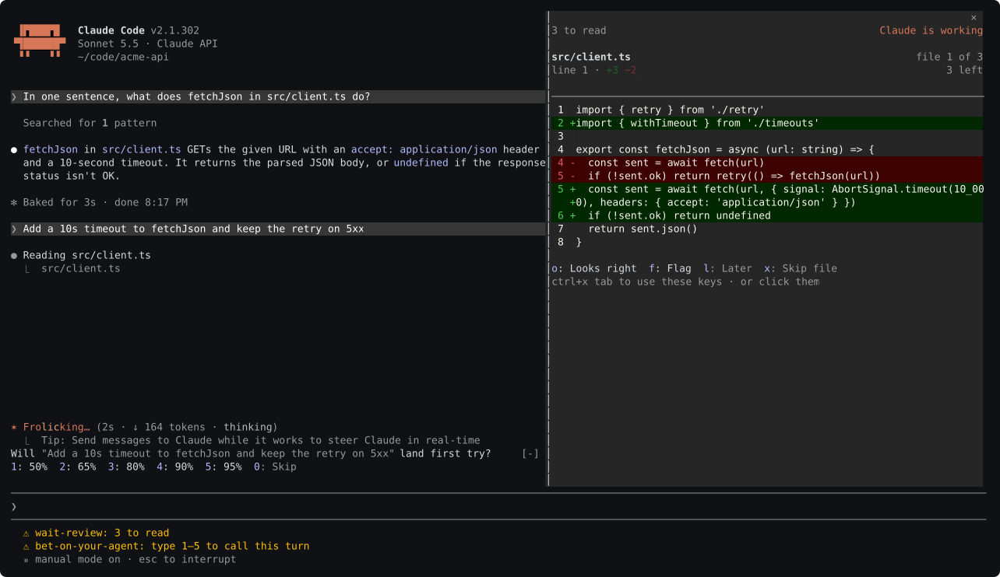
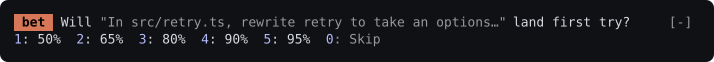

# bet-on-your-agent


One of four rooms in [waitroom](../README.md#one-family-four-rooms):
[wait-review](../wait-review) (the diff) ·
**bet-on-your-agent (your calibration)** ·
[wait-ship](../wait-ship) (what ships) · [wait-breathe](../wait-breathe) (you).

A Claude Code plugin that scores how well you call your own agent. While a turn
runs, the row above the prompt asks you how it will go. Afterwards it tells you
how calibrated you were.

```
/plugin marketplace add coindef/waitroom
```
```
/plugin install bet-on-your-agent@waitroom
```

All four rooms at once: `/plugin install waitroom@waitroom`.

(Each as its own message; both are safe to send again. Needs Claude Code
2.1.291 or later; `claude update` if `claude --version` says otherwise.)

## Why calibration, not a wager

The most valuable skill in agentic coding is knowing how far to trust the agent
on the task in front of you, and how much context it needs to get there. Right
now that skill is learned entirely by vibes.

So this keeps no currency and no winnings. Guessing well against a house teaches
you to guess; being scored on your honesty teaches you to judge. It uses the
**Brier score** — the mean squared error of a forecast against what happened —
which is a *proper* scoring rule: you cannot improve it by shading an answer
away from what you actually believe. The payoff is not a number, it is the line
that says you run twelve points overconfident on the turns you call at 90%.

The forecast also fits the wait exactly. It takes one keypress, it is about the
thing already on your mind, and the window closes on its own when the turn
lands.

## What it does



*A real capture (Claude Code 2.1.311), not a mockup. The ship offer was
answered a moment before, so "Did it land?" has the row.*

It lives just above the prompt, which is where you are already looking
while you wait. **Type 1 to 5 into an empty composer and it answers** — no
pane to place, no focus to manage, nothing to click. (`0: Skip` is the one key
that wants the row's focus first, `ctrl+x tab` or a click: on 2.1.311 a bare
`0` stays in the composer.)



The orange `bet` tag names the row, so a question that appears above the
prompt says whose it is. `0` waves the turn away and the band goes quiet for the rest of it: a prompt you
cannot dismiss is a nag.

Answer that and it asks the next thing, never both at once, so the digits
always mean the obvious thing:

```
 bet  you said 80% · how many files will it touch?
1: none  2: one  3: 2–3  4: 4+  0: Skip
```

The small counts are words on purpose: pressed by digit, `1: 0  2: 1` put "one
file" on the 2 key.

While the turn runs the row goes quiet — `bet 80% · 2–3 files · 1 written so
far` — and the count turns amber once it passes what you called. When the turn
lands, the question leads and the ask trails, so a narrow row cuts the ask and
never the question:

```
 bet  Did it land? you said 80% · "add the retry logic to the client"
1: Landed  2: Needed fixing  0: Skip
```

The row is shared with `wait-changed`, `wait-ship`, and `wait-breathe`, and
shows one of them at a time. Between turns a `wait-changed` summary comes
first when that mod is installed and the turn changed files, then a ship
offer, and "Did it land?" takes the row once those are dismissed. While a
turn runs, only a breathe nudge holds the forecast back, since the window to
call the turn closes when it lands.

- **Will it land first try?** Resolved by your own verdict, which it asks for
  once the turn lands — with a `skip` if you would rather not say. Answered it
  wrong? The band holds what it recorded for one more press of `u: Undo`,
  until the next turn starts.
- **How many files?** Resolved automatically, so it needs no verdict at all.
  In a git repository it counts every file whose content the turn changed,
  however it was written — an agent that writes through a shell heredoc makes
  no `Edit` call. Outside one, it counts the `Edit`, `Write` and
  `NotebookEdit` calls the turn made.

From your second week (see [Your first week](#your-first-week)), once those
are answered, one more optional question rotates in — how long the turn will
take, how many files (again, as a bucket of three this time), or how many tool
calls it will make — one dimension per turn, cycling through all three over
time. Same `skip`, costing nothing:

```
 bet  Bonus: how long will this turn take?
1: <30s  2: 30-90s  3: >90s  0: Skip
```

The forecast is quoted against **what you asked for**, which is the point: a
score tells you that you are overconfident, the ask tells you what about.

`/bet` opens the record:

```
You run 12 points overconfident.
Brier 0.147 over 23 scored turns — better than a coin flip.
Rank: Gold.

 said     actual   turns
  50% →     60%    5   underconfident
  80% →     64%   11   overconfident
  95% →     71%    7   overconfident

Worst calls
  95% and it did not — refactor the auth layer to use the new client
  95% and it did not — make the config loader handle overrides
  80% and it did not — rename the session helpers

File count called right 14/23.
Bonus: 15/23 correct.
The agent landed it first try 65% (15/23).
Median turn 42s.
```

Until five calls are scored it says `Calibrating ●●○○○ 2 of 5 calls` instead,
and so does the status line: two misses read as "80 points overconfident",
which is a verdict on almost nothing. Repeats of the same ask fold into one
worst-call line marked `×2`.

The headline is in words because "Brier 0.147" means nothing on its own. The
table is the part that teaches, and **Worst calls** is the part that teaches
fastest: it is always a specific kind of ask you misjudge, not forecasting in
general.

Every turn is recorded whether you bet on it or not, so even without forecasting
you accumulate the thing that is genuinely hard to intuit: how often your agent
actually lands it, how many files it actually touches, and how long it actually
takes.

## Rank

The record also carries a rank, from the Brier score over your last 20 scored
turns rather than the lifetime one, so it reflects how you are calling it
lately: `Coin-Flipper`, `Bronze`, `Silver`, `Gold`, `Platinum`, `Oracle` — or
`Unranked` under five scored turns. It sits beside the pane's own tag, and
climbing a level prints one line once: `Rank up: Silver → Gold`.

## Your first week

For someone new, the first seven days are the core loop alone: the forecast,
the file count, the verdict, the calibration and the rank. The bonus question,
the daily challenge and the badge wall stay out of the row and out of `/bet`
until then — nothing is switched off, they are simply not pushed at you while
you learn the two questions that matter. They are all in `/bet-recap` from the
first day: the badges with their progress, and the bonus and daily-challenge
rows saying when they start (`starts in 7 days`, then `starts tomorrow`).

The week is counted on this machine's own calendar, from the first session
this version meets you in — no account, nothing fetched. Anyone who already has
a record keeps everything they had, from that session on.

## Badges

Six badges sit beside the record in `/bet` and `/bet-recap` (only
`/bet-recap` in your first week), always the full set, earned or locked, so
the wall never changes shape: **First Steps** (one
scored call), **Hot Streak** (5 landed calls running), **Sharpshooter** (ten
straight scored calls under a 0.20 Brier), **Oracle Path** (reaching the top
rank once, lifetime), **Bonus Hunter** (five bonus questions right), and
**Regular** (five distinct days with a scored bet).

## Daily challenge

Once a day from your second week, one optional yes/no question rides the
same row as the bonus question — will this turn beat your own median on whichever dimension the
date picks (duration, files, or tool calls) — scored the moment the turn
lands, no verdict needed from you:

```
 bet  Daily challenge: will this turn touch more files than your median?
1: Yes  2: No  0: Skip
```

Before five calls are scored, it asks against a fixed stand-in turn instead
and says so ("...than a typical turn?"), since there is no personal median
yet to judge against. In a narrow terminal the question wraps onto a second
line rather than being cut. `/bet-recap`'s "Daily challenge" row shows a run of
right days once it reaches two (`4-day streak`), else today's own result.

## Commands

| Command | What it does |
| --- | --- |
| `/bet` | Prints your record and opens the pane |
| `/bet-recap` | A shareable, plain-text recap card for this session, sized to fit the terminal it is printed in; in your first week, also where the badges and extras are |

## Settings

| Option | Default | What it means |
| --- | --- | --- |
| `autoOpen` | `false` | Open the record pane at session start. Off by default: betting lives in the band, so the pane is only worth space when you want to read the record. |

## How the scoring works

- **Brier score** is the mean of `(forecast − outcome)²`. Lower is better.
  Saying 50% every time scores exactly `0.25`, so anything under that beats no
  skill at all, and anything over it means your confidence is actively
  misleading you.
- **The calibration table** is the part worth reading. One row per forecast you
  actually used, because a single score hides *which kind* of turn you misjudge.
- **Interrupted turns are recorded but never scored.** Stopping a turn yourself
  says nothing about the agent.
- **A bet with no verdict waits — for four hours.** It is never counted as a
  loss, so leaving one unanswered costs you nothing but the sample. Press `skip`
  and it is dropped from scoring entirely while the turn stays on the record.
  Leave it longer than four hours and it lapses the same way, so a new session
  never opens by asking about a turn you no longer remember.
- **A call that was nearly right is never held up as a worst call.** Only a miss
  wider than a coin flip makes that list.
- **"Landed" is your judgement**, which is the honest design: the thing being
  calibrated is your judgement, so it is also the ground truth.

History is kept in the plugin's own store, so it survives across sessions.
It holds the last 500 turns.

## Developing

```
claude plugin validate .     # manifest and hooks, as the engine reads them
claude plugin test .         # 130 tests
```

The scoring lives in `hooks/bet.ts` with no engine dependency and is tested
directly; `hooks/register.tsx` is the hooks module and `types/index.d.ts` the
state contract. `tests/band.test.tsx` drives the whole loop through the engine:
place a bet while a turn runs, land the turn, answer the verdict, and read the
call back out of the record.
