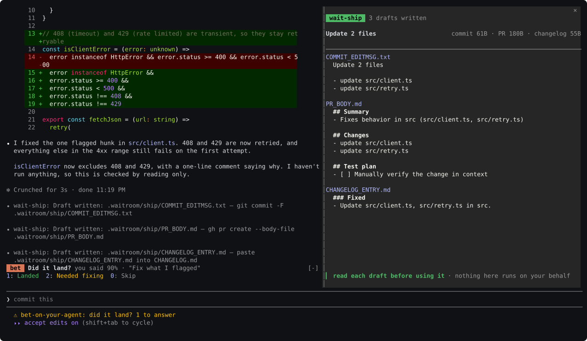

# Design

## How they share the screen

They compose rather than compete for room. **wait-review** takes the pane, and
the others share the row just above the prompt, one at a time: a breathe
nudge first, then — once a turn has ended and it changed files —
wait-changed's list, then a ship offer, then the bet's question. Two sets of
buttons never stack there; the one behind waits its turn. `Close` on the list
is what gives the ship offer the row. While a turn runs, the bet's forecast
gives way only to a breathe nudge, since the window to call the turn closes
when it lands, and the diff card is not drawn yet.

## The idea

The cost of waiting on a coding agent is not boredom, it is context collapse. A
90-second wait filled with something entertaining costs minutes of refocus on
the way back, and any game with a win condition quietly teaches you to want the
agent to be slow. You also cannot win on entertainment: the person already has a
phone.

So none of these compete with a phone. Each spends the wait on something that
is only available *during* the wait, needs no context switch to start, and can
be abandoned mid-thought:

- **wait-review** spends it on the diff, because the agent now writes code
  faster than anyone reads it and a session otherwise ends with a large diff
  nobody reviewed.
- **bet-on-your-agent** spends it on a forecast, because knowing how far to
  trust the agent is the skill that matters most and is currently learned by
  vibes.
- **wait-ship** spends it on the words around the diff, because a commit
  message and a PR description are worth getting right too, and writing them
  well after the fact competes with whatever comes next instead of riding the
  one moment the change is already fresh in mind.
- **wait-breathe**, alone of the four, spends it on you rather than the work —
  the same wait that is free for the others to fill is the only unscheduled
  moment in a long session. It is off by default because not everyone wants a
  plugin making that particular claim on their attention.

bet-on-your-agent asks what you expect from what Claude is writing, wait-ship
hands you the words for what it just wrote, and wait-breathe — once you turn it
on — asks something of you instead of Claude.
