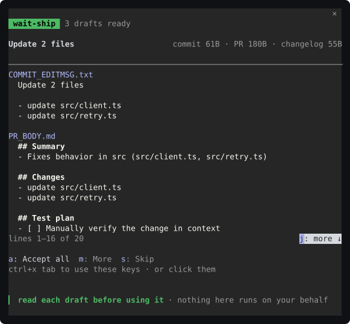
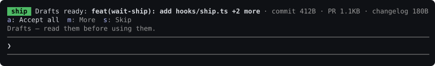
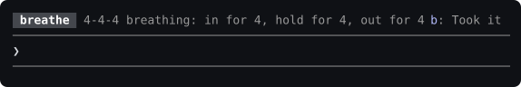

# Install


```sh
claude plugin marketplace add coindef/waitroom && claude plugin install waitroom@waitroom
```

Star it on GitHub if it earned it.

That installs wait-review, bet-on-your-agent, wait-ship, and wait-breathe.

Optional — turn-end file list (not in the four-room install):

```sh
claude plugin install wait-changed@waitroom
```

After a turn that changed files, lists them above the prompt. Read-only. Skip if you only want the four rooms. [What it shows](../wait-changed).

Optional — local notification when a long turn ends (not in the four-room install):

```sh
claude plugin install wait-ping@waitroom
```

A turn under 30 seconds ends quietly. Sound stays off until you turn it on. [What it sends](../wait-ping).

Optional — warn when a turn edits outside the scope you set (not in the four-room install):

```sh
claude plugin install wait-scope@waitroom
```

Put one glob per line in `.claude/wait-scope` (or set *Files in scope*). Only warns. [What it shows](../wait-scope).

Optional — flag lines a turn wrote that look like a key or token (not in the four-room install):

```sh
claude plugin install wait-secret@waitroom
```

Masked, local regex over this turn's added lines. Only warns. [What it shows](../wait-secret).

Then start Claude Code (restart it, if it was already running). Each room runs
on its defaults — no key, no service, nothing written to your repository.
wait-breathe stays off until you send `/breathe`. The installer's `userConfig
options not yet set` lines are fine: every option has a working default
([more](#what-the-installer-says-on-the-way-in)).

Already at the Claude Code prompt? Send two slash commands, each as its own
message — `/plugin marketplace add coindef/waitroom`, then `/plugin install
waitroom@waitroom` — and save the install screen as it is.

Both halves are safe to run again: adding a marketplace that is already there,
or installing a plugin that already is, changes nothing. With the four rooms
in, `/plugin` reads `4 mods active · wait-review, bet-on-your-agent,
wait-ship, wait-breathe`.

## Or install one room

```sh
claude plugin install wait-review@waitroom
claude plugin install bet-on-your-agent@waitroom
claude plugin install wait-ship@waitroom
claude plugin install wait-breathe@waitroom
```

The marketplace add in the line above still comes first. At the prompt, each
of those is its own message: `/plugin install wait-review@waitroom`, and the
same shape for the other three.

Every plugin here needs **Claude Code 2.1.291 or later** — `claude --version` says which you
have, `claude update` moves you on. An older build installs it without
complaint and then shows it as `failed to load`; see
[If a plugin shows an error](troubleshooting.md#if-a-plugin-shows-an-error).

The one-liner adds the marketplace from its repository path,
`coindef/waitroom`. From then on the marketplace goes by its name,
**`waitroom`**, the part after the `@`. `waitroom@waitroom` is this four-room
install.

You may also see `/plugin install waitroom --marketplace coindef/waitroom`.
It works once. Sent again, it answers `Plugin "waitroom" not found in any
marketplace`, because by then `--marketplace` wants the name `waitroom`, not
the repository path. The one-liner above has no such trap.

## Updating

Run these at the prompt, then **restart Claude Code** — an update is written to
disk straight away but only loaded by the next session:

```
/plugin marketplace update waitroom
/plugin update waitroom@waitroom
/plugin update wait-review@waitroom
/plugin update bet-on-your-agent@waitroom
/plugin update wait-ship@waitroom
/plugin update wait-breathe@waitroom
/plugin update wait-changed@waitroom
/plugin update wait-ping@waitroom
/plugin update wait-scope@waitroom
/plugin update wait-secret@waitroom
```

`/plugin update waitroom@waitroom` picks up a room newly added to that install.
Each room still updates on its own line. Each reports `updated from` the old
version `to` the new one, or `already at the latest version` for a mod that
has not changed. What changed, and in which mod, is in
[CHANGELOG.md](../CHANGELOG.md); if one it lists as changed still says it is at
the latest version, the marketplace was not refreshed yet, so run the first
line again.

## Coming from the old name

The repository was called `Plugin`, and the marketplace `wait-mods` (in the
very first release, `wait-review`). If you installed under one of those, the
stale marketplace is still registered and has to go before the new one can take
its place. `/plugin marketplace list` shows which you have. Removing a
marketplace uninstalls the plugins that came from it, so remove the old one,
then install again:

```
/plugin marketplace remove wait-mods
/plugin marketplace add coindef/waitroom
/plugin install waitroom@waitroom
```

(From the first release, the first line is `/plugin marketplace remove
wait-review` instead.) Leave the old one in place and one of the two copies
reports `holds the same plugin name and comes first` — see
[If a plugin shows an error](troubleshooting.md#if-a-plugin-shows-an-error).

bet-on-your-agent's record does not come with it: each install keeps its own,
so your calibration starts fresh under the new name.

## Screenshots

<p align="center">
  
  
  
  
</p>

<p align="center"><em>Real captures from this build, not pixel mockups. The walkthrough is in <a href="../README.md#plugins">The first minute</a>.</em></p>

<!--
  Optional pixel screenshot strip, when Design ships stills:
  ads/assets/screenshots/readme-shot-review.png
  ads/assets/screenshots/readme-shot-bet.png
  ads/assets/screenshots/readme-shot-ship.png
  ads/assets/screenshots/readme-shot-breathe.png
-->

## Requirements

- **Claude Code 2.1.291 or later, run interactively** — the current stable
  release, 2.1.304, is fine. Checked live on 2.1.291, 2.1.292, 2.1.300,
  2.1.302 and 2.1.304. Older builds do not run them, and `claude update` is the fix:
  - before 2.1.242, the plugins show `failed to load` (below);
  - 2.1.242 to 2.1.280 install them but reject their hooks module, which uses
    state helpers those builds predate (`claude plugin validate` says so on
    2.1.242, 2.1.260 and 2.1.280);
  - 2.1.281 to 2.1.290 accept the module but were not run live.
- **A git repository** for wait-review and wait-ship. Both read the diff, so
  outside one they have nothing to show. bet-on-your-agent and wait-breathe
  work anywhere.
- Plugins that hook Claude Code's own events are **early access**. See
  [If a plugin shows an error](troubleshooting.md#if-a-plugin-shows-an-error).

## What the installer says on the way in

**"4 userConfig options not yet set"** is informational: every option has a
working default and the plugin runs on them — the debug log puts it as `every
option is its default`. Configure them to change something, not to get started.
