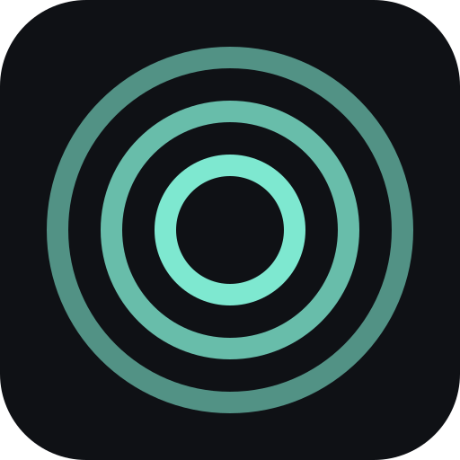
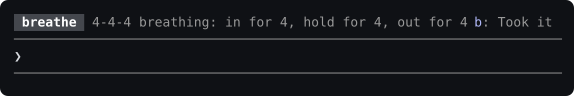

# wait-breathe



One of four rooms in [waitroom](../README.md#one-family-four-rooms):
[wait-review](../wait-review) (the diff) ·
[bet-on-your-agent](../bet-on-your-agent) (your calibration) ·
[wait-ship](../wait-ship) (what ships) · **wait-breathe (you)**.

A Claude Code plugin that asks you, once in a while, to take care of yourself
during a long turn. Off by default.

```
/plugin marketplace add coindef/waitroom
```
```
/plugin install wait-breathe@waitroom
```

(Each as its own message; both are safe to send again. Needs Claude Code
2.1.291 or later; `claude update` if `claude --version` says otherwise.)

## Why this is off by default

Every other mod in this marketplace earns its place by giving the wait
something to do. This one does the opposite on purpose: the only thing it asks
is that you, not the agent, get a turn once a session runs long. That is a
different kind of claim on your attention, and not everyone wants a plugin
making it — so it stays silent until you turn it on.

**To turn it on:** send `/breathe`. The next `/breathe` turns it off again.
It is the same switch as *Enable the breathing nudges* on this mod's install
screen and under `/plugin` → `wait-breathe`, so flipping it either way moves
both.

## What it does

Turned on, nothing changes about a normal turn. Only once a single turn runs
past `longTurnSeconds` (90 by default) does one line show up in the row above
the prompt — the same row `bet-on-your-agent` and `wait-ship` use:



*A real capture (Claude Code 2.1.311), not a mockup. The tag stays grey on
purpose: of the four rooms' tags, this one is the quietest.*

That's the whole interaction. No health claim, no "you should," just the
action: posture check, a 20-20-20 eye break, 4-4-4 breathing, or stand up and
stretch — rotating in that order, so it is never the same one twice running.
If you want it counted, give the row the keys (`ctrl+x tab`, or a click) and
press `b`; a letter typed into the prompt stays in the prompt. If not, carry
on: it clears itself once the turn ends either way.

- **At most one line per turn.** However long the turn keeps running past the
  threshold, it already said its one thing.
- **At most one line every ten minutes**, regardless of how many turns run
  long in between.
- **Zero required keys.** Nothing here ever needs an answer — not even the
  `Took it` button, which only exists to let the count mean something.
- **It comes first in the shared row.** The row shows one mod at a time, so
  while the nudge is up a `bet-on-your-agent` question waits behind it rather
  than stacking a second row of buttons on top, and has the row back the
  moment you press `b` or the turn ends. Only a survey of Claude Code's own
  holds the nudge back.

When the session ends, one line goes into its transcript, the same way
`wait-review` records a session's reading:

```
wait-breathe: 3 nudges, 2 taken this session
```

Claude Code is closing by then, so this line is for the record rather than
the screen. It is written only when at least one nudge actually showed. A
quiet session — nothing ran long, or the plugin is off — writes nothing.

## Commands

| Command | What it does |
| --- | --- |
| `/breathe` | Turns the nudges on, or off again, and says which it is now |

```
wait-breathe: on · one quiet nudge once a turn runs 90s · /breathe again turns it off
wait-breathe: off · /breathe turns it on
```

(Claude Code puts the plugin's name in front of every reply, so the reply
itself starts at the state.)

If the setting cannot be changed, nothing moves and the reply says so, with
where else the switch lives:

```
wait-breathe: still off · the setting did not change (<the reason>) · /plugin → wait-breathe → Enable the breathing nudges
```

Turned on, the nudges start from the next turn, not one already running.
Turned off, nothing more shows from that moment. `/breathe` is also how to
find this mod again once the install screen has scrolled past, since there is
no pane to stumble into otherwise.

## Settings

| Option | Default | What it means |
| --- | --- | --- |
| `enabled` | `false` | Turn the nudges on. Off means zero output, ever. `/breathe` flips it. |
| `longTurnSeconds` | `90` | How long a single turn runs before one nudge appears. |

## What it does not do

- **No sensors, no biometrics, no timers outside the turn you are already
  waiting on.** It reads nothing about you — only how long the current turn
  has been running.
- **No health claims.** Each nudge names an action, never a benefit. This is
  not medical advice and does not pretend to be.
- **No network, no account, no telemetry.** Everything it keeps lives in its
  own local store, the same as `bet-on-your-agent`'s record.
- **Nothing here blocks a turn.** A failure in this plugin never swallows a
  prompt or an edit — the hooks that would gate anything simply pass the call
  through.

## Developing

```
claude plugin validate .     # manifest and hooks, as the engine reads them
claude plugin test .         # 28 tests
```

The rotation, the cooldown, the session counting and the `/breathe` reply
lines live in `hooks/breathe.ts` with no engine dependency and are tested
directly; `hooks/register.tsx` is the hooks module and `types/index.d.ts` the
state contract. `tests/flow.test.tsx` drives the whole loop through the engine
with the mock clock, arming the threshold at `turn.start` and advancing past it
the way a real long turn would — including `/breathe` flipping the setting
both ways, and the nudge taking the shared row from a bet question or a ship
offer beneath it.
