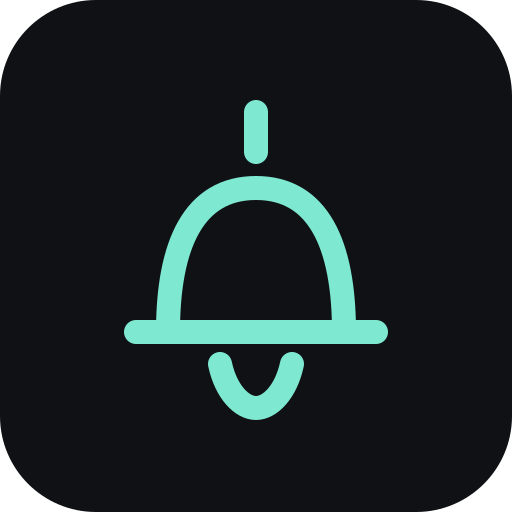

# wait-ping



A Claude Code plugin that sends a notification through the operating system
on this machine when a turn ends, or when a permission confirm is waiting.
Local only. Sound stays off until you turn it on.

```
/plugin marketplace add coindef/waitroom
```
```
/plugin install wait-ping@waitroom
```

This install stays on its own. The four rooms are `/plugin install waitroom@waitroom`.

(Each as its own message; both are safe to send again. Needs Claude Code
2.1.291 or later; `claude update` if `claude --version` says otherwise.)

## What it does

Two moments, and nothing else:

- **A turn ends** (`turn.complete`, the same turn-end hook the other mods
  use). If it ran at least `thresholdSeconds` — 30 by default — a notification
  says `You were away 45s`. That time is how long the turn ran. Under a
  minute it stays in seconds (`45s`). An exact minute is `1m`. A minute and
  a half is `1m 30s`. A shorter turn sends nothing. A turn you interrupted,
  and a subagent's turn, send nothing.
- **A permission confirm is waiting** (Claude Code's Notification hook, type
  `permission_prompt`). That type is sent once the confirm has been waiting,
  and it is not sent if you answer first. It notifies even when the turn is
  still under the threshold: `Needs your OK`. Other notification types,
  including `idle_prompt`, do not.

The title is `Waitroom`. "You were away" is the turn's own clock. Nothing
here tracks a separate away time, and nothing is sent anywhere.

`/wait-ping` turns notifications off, and the next `/wait-ping` turns them
back on. It is the same switch as *Notify when a turn ends or needs
permission* under `/plugin` → wait-ping. Sound and the threshold are not
flipped by that command.

```
wait-ping: on · a local notification once a turn runs 30s, or when a permission confirm is waiting · sound off · /wait-ping again turns it off
wait-ping: off · /wait-ping turns it on
```

(Claude Code puts the plugin's name in front of every reply, so the reply
itself starts at the state.)

A missing notification program, or a desktop that cannot show one, fails
quietly. The turn still ends.

## macOS and Linux

The hook runs `uname` (no arguments) to tell the two desktops apart, then one
local program. It does not open a shell and it does not open a connection.
Anything `uname` does not answer as `Darwin` or `Linux` sends nothing. A short
turn does not run `uname`.

**macOS** — `osascript`, silent unless sound is on:

```sh
osascript -e 'display notification "You were away 45s" with title "Waitroom"'
```

With sound on, the same call adds `sound name "Ping"` (`Ping` is a built-in
macOS sound):

```sh
osascript -e 'display notification "You were away 45s" with title "Waitroom" sound name "Ping"'
```

If nothing appears, run `osascript -e 'display notification "test"'` once in
Terminal. Open System Settings → Notifications, find Script Editor, and allow
notifications. Script Editor is what `osascript` notifies through.

**Linux** — `notify-send`, silent unless sound is on:

```sh
notify-send "Waitroom" "You were away 45s"
```

With sound on, the same call adds a hint and still does not start a second
program:

```sh
notify-send --hint=string:sound-name:message-new-instant "Waitroom" "You were away 45s"
```

`notify-send` comes from `libnotify` (`libnotify-bin` on Debian and Ubuntu).
It needs a desktop notification daemon. A headless session or an SSH session
without one has nowhere to show the notification; the hook still only runs
that command. A desktop may ignore the sound hint when it has no sound theme.
The notification itself still does not ask for a sound unless sound is on.

## Settings

| Option | Default | What it means |
| --- | --- | --- |
| `enabled` | `true` | Send the notifications. Off means nothing is sent. `/wait-ping` flips it. |
| `sound` | `false` | Play a sound with the notification. Off leaves it silent. |
| `thresholdSeconds` | `30` | How long a turn runs before a stop notification. A permission confirm does not wait for this. |

## What it does not do

- **No network.** No cloud push, email, Slack, or telemetry. The only
  programs it runs are `uname`, then `osascript` or `notify-send`.
- **No sound unless you turn sound on.**
- **No notification for a short turn** that is not waiting on a permission
  confirm.
- **No separate away tracker.** `You were away 45s` is the turn's own
  duration.
- **Nothing here blocks a turn.** A failure passes the hook through.

## Developing

```
claude plugin validate .
claude plugin test .
```

The gate, the copy, and the `osascript` / `notify-send` arguments live in
`hooks/ping.ts` with no engine dependency and are tested directly.
`hooks/register.ts` is the hooks module. `tests/flow.test.ts` drives a turn
ending and a Notification event through the engine, with `process.run`
answered by the test so the suite never posts a real notification.
