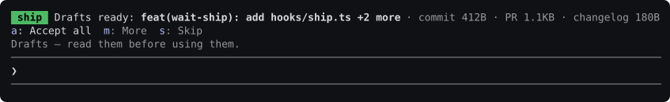

# wait-ship

A Claude Code plugin that drafts the words around the turn's changes — the
commit message, the PR description, the changelog entry — the moment the
turn lands, so you can review them the way `wait-review` lets you review the
diff itself.

```
/plugin marketplace add coindef/waitroom
```
```
/plugin install wait-ship@waitroom
```

(Each as its own message; both are safe to send again. Needs Claude Code
2.1.291 or later; `claude update` if `claude --version` says otherwise.)

## Why drafts, not a tool call

An agent can already write a commit message. What it cannot do unprompted is
hand you something to read, correct, and use on your own time — so this reads
the diff the turn already wrote, the same diff `wait-review` reads, and turns
it into three things worth looking at before you ship: a commit message, a PR
description, and — only where one applies — a changelog entry.

It never runs `git commit`, never runs `gh`, never touches `CHANGELOG.md`. It
writes drafts to their own folder and tells you the exact command to run if
you want them. The ship is still yours.

## What it does

When a turn ends having changed anything, the row above the prompt — the same
one `bet-on-your-agent` uses — offers the kit it drafted:



```
 ship  Drafts ready: feat(wait-ship): add hooks/ship.ts +2 more · commit 412B · PR 1.1KB · changelog 180B
a: Accept all  c: Commit msg  p: PR body  l: Changelog  e: Drafts for editing  s: Skip
```

**Type the bare letter into an empty composer and it answers** — no focus
needed, same as `bet-on-your-agent`'s digits: no pane to place, nothing to
click.

- **`a` accepts every drafted artifact.** `c`, `p` and `l` write just the one.
  `e` writes the same drafts as `a`, framed for editing rather than for
  immediate use — all of them are called drafts either way.
- **`s` skips.** Nothing is written, and the row goes quiet.
- Accepted drafts are written under `shipDir` (`.waitroom/ship` by default):
  `COMMIT_EDITMSG.txt`, `PR_BODY.md`, `CHANGELOG_ENTRY.md`. The row then
  prints exactly what to run:

```
Drafts written:
  .waitroom/ship/COMMIT_EDITMSG.txt — git commit -F .waitroom/ship/COMMIT_EDITMSG.txt
  .waitroom/ship/PR_BODY.md — gh pr create --body-file .waitroom/ship/PR_BODY.md
```

Nothing here is ever executed on your behalf — not the commit, not a `gh`
call, not an edit to `CHANGELOG.md`. The row names the command; you decide
whether to run it.

**No changes, no row.** A turn that touched nothing leaves this plugin
completely silent, same as a turn with nothing for `wait-review` to show.
**Outside a git repository**, same thing — there is no diff to draft from.

## What goes into each draft

- **Commit message.** The subject line is derived from the files changed:
  which ones, where, and roughly what kind of change they look like (a new
  file reads as a feature, an all-test diff reads as `test`, and so on) —
  guessed from the diff alone, since this is deterministic text generation,
  not a model call. It looks at your last 20 commit subjects first: if most
  of them are conventional commits (`type(scope): subject`), it writes one of
  those; otherwise it matches the prevailing capitalization and tense
  instead. The body is short bullets, grouped by area once the diff touches
  more than one.
- **PR description.** `## Summary` (2-4 bullets on what changed and roughly
  why, read off the files — a diff carries no rationale a deterministic pass
  can honestly invent), `## Changes` (the same per-area bullets as the commit
  body), `## Test plan` (a checkbox per test file the diff touched, plus one
  manual-verification line always).
- **Changelog entry**, only when `CHANGELOG.md` exists in the repository
  root and `includeChangelog` is on: 1-2 bullets under `### Added`, `###
  Changed` or `### Fixed`, picked the same way the commit type is. It is a
  standalone snippet to paste in yourself — this plugin never edits
  `CHANGELOG.md`.

## Settings

| Option | Default | What it means |
| --- | --- | --- |
| `enabled` | `true` | Draft a kit at the end of each turn that changed anything. |
| `shipDir` | `.waitroom/ship` | Repository-relative folder accepted drafts are written into. |
| `includeChangelog` | `true` | Draft a changelog entry when `CHANGELOG.md` exists. |

## What it does not do

- **No network, no `gh`, no git write of any kind.** Reading the diff and the
  recent log is the only git it runs.
- **No model call.** Every word is generated by a fixed, deterministic pass
  over the diff — the same input always produces the same draft.
- **It does not guess at your reasons.** The "why" in a PR summary is limited
  to what kind of change it is and where — a diff alone cannot honestly say
  more than that.
- **It never executes what it prints.** The apply commands are text. Running
  them is always a separate, deliberate step you take.

## Developing

```
claude plugin validate .     # manifest and hooks, as the engine reads them
claude plugin test .         # 53 tests
```

The diff parsing, style inference and every drafted artifact live in
`hooks/ship.ts` with no engine dependency and are tested directly against
fixture diffs and fixture commit histories. `hooks/register.tsx` is the hooks
module; `types/index.d.ts` is the state contract. `tests/flow.test.tsx` drives
the whole loop through the engine, with git and the filesystem answered by the
test — including a turn with no changes, one outside a repository, and each
of the band's keys actually writing (or not writing) the right files.
